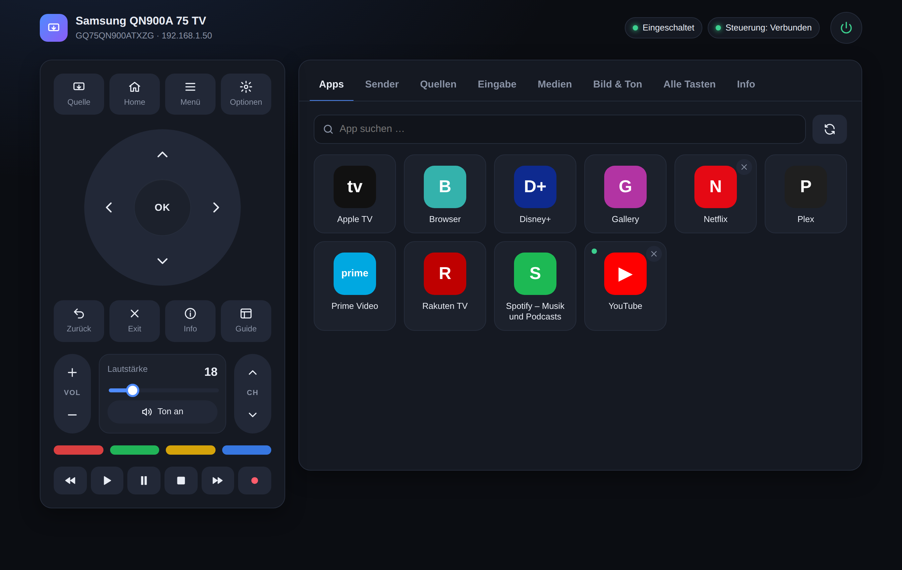

# TV Web Remote

A clean web interface for Samsung Tizen TVs – remote control, apps, volume, text input and media playback in your browser. Runs locally on your home network, no cloud required.

**Website:** https://mupf-dev.github.io/samsung-tv-web-remote/



Built and tested with a Samsung GQ75QN900ATXZG (QN900A, Tizen, 2021). Other Samsung Tizen TVs from around 2018 onwards use the same interfaces and should work too, but this has not been tested. The interface itself is currently in German.

## Features

- **Complete remote control:** D-pad, Home, Menu, Back, color and playback keys; press and hold to repeat
- **Apps:** launch, close and search installed apps, with an indicator for running apps
- **Volume:** exact volume slider and mute with live readout (DLNA)
- **Channels & inputs:** number pad, channel list, guide, teletext, TV and HDMI 1–4
- **Text input & touchpad:** type into the TV keyboard, move the pointer, open web pages in the TV browser
- **Media:** play video, audio or image URLs from your network on the TV (DLNA)
- **All keys:** every key on its own, plus any custom `KEY_…` code
- **Power:** on from standby via `KEY_POWER` or Wake-on-LAN (also from WSL2)
- **Responsive:** phone to desktop, light and dark theme, keyboard shortcuts
- **Optional SmartThings:** direct picture mode, sound mode, input and channel selection

## Quick start

Requirements: Node.js 18 or newer and a Samsung Tizen TV on the same network.

```bash
git clone https://github.com/mupf-dev/samsung-tv-web-remote.git
cd samsung-tv-web-remote
npm install
cp config.example.json config.json   # enter your TV's IP and MAC address
npm start                            # http://localhost:8097
```

You can find the TV's IP and MAC address under Settings › General › Network › Network Status › IP Settings.
On first start the TV asks once for permission – confirm with “Allow”. The pairing token is stored in `data/token.json`.
`config.json` and `data/` are excluded from git via `.gitignore`.

## Configuration

`config.json`:

| Key | Description |
|---|---|
| `port` | Port of the web interface (default `8097`) |
| `tv.host` | IP address of the TV |
| `tv.mac` | MAC address, used for Wake-on-LAN |
| `tv.name` | Name shown on the TV when pairing |
| `wolBroadcast` | Broadcast address for Wake-on-LAN, e.g. `192.168.1.255` |
| `smartthings.token` / `.deviceId` | Optional SmartThings access; the device is detected automatically if `deviceId` is empty |
| `extraApps` | Optional list of additional Tizen app IDs to show |

## How it works

| Feature | Interface |
|---|---|
| Remote keys, text input, touchpad, browser | WebSocket `wss://TV:8002` with token pairing |
| Status, checking, launching and closing apps | REST `http://TV:8001/api/v2` |
| Volume, mute, media playback | DLNA/UPnP `http://TV:9197` |
| Power on from standby | `KEY_POWER`, otherwise Wake-on-LAN (under WSL also sent via Windows) |
| Picture mode, sound mode, inputs, direct channel | optional SmartThings API |

## Limitations

- **App list:** newer firmware no longer answers the request for installed apps, so the known IDs in `server/apps-catalog.js` are checked one by one. Add missing apps to `config.json` under `"extraApps": ["…"]`.
- **Picture settings:** brightness, contrast, equalizer etc. are not exposed by the TV; they remain reachable via Menu and the D-pad.

## License

[MIT](LICENSE) · Not an official Samsung product. Samsung and Tizen are trademarks of Samsung Electronics Co., Ltd.
